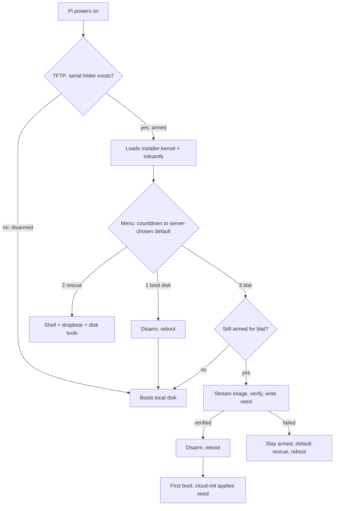

# FreshPi

Reinstall Raspberry Pis over the network. An armed Pi network-boots a small installer that
writes a clean Raspberry Pi OS Lite image to its disk, seeds first boot (user, SSH key,
hostname) and reboots into it. An HDMI menu with a countdown lets someone at the Pi stop it,
pick a rescue shell, or just boot the existing disk.

Typical use: give a set of test Pis a fresh OS for every release of the software they run,
without touching SD cards.


## Why not a standard network installer?

Network-install tools such as MAAS, Tinkerbell, netboot.xyz and iVentoy chain-load iPXE or
GRUB, which needs UEFI or a PC BIOS on the client. The Raspberry Pi 5 bootloader has neither,
and the Pi 3 boot ROM ignores the DHCP boot filename. What both can do is fetch firmware, a
kernel and an initramfs by TFTP, from a folder named after the board's serial number. FreshPi
supplies that kernel and initramfs, plus a small server that decides, per Pi, whether it gets
them.

## How it works

- **Arming.** A Pi is armed when `<tftp-root>/<serial>/` exists. Its bootloader then loads the
  installer from that folder. When disarmed, the request misses and the Pi falls through to its
  local disk. So the TFTP root itself must never hold `config.txt`, `start.elf` or a kernel
  (`freshpi list` warns if it does).
- **Menu** (HDMI + USB keyboard): 1 boot local disk (disarms), 2 rescue shell, 3 blat. The
  server sets the default item and the countdown (see [Use](#use)). Any key stops the countdown
  and waits. Choosing 3 by hand asks you to type `yes`, unless `FRESHPI_CONFIRM_BLAT=no` is set
  in the server's config (then the keypress alone starts the blat).
- **Blat** writes only to the disk registered for that serial, and refuses if: the server no
  longer says "armed + blat" at the moment of writing, the board model differs from the
  registered one, or the target disk is missing. It checks the sha256 of the image while
  writing and of a read-back of the disk, writes the first-boot seed, and only then tells the
  server `done`, which disarms the Pi. Any failure leaves the Pi armed with rescue as the
  default.
- **Seed**: Raspberry Pi OS uses cloud-init (NoCloud, from the boot partition). `user-data`
  creates `FRESHPI_USER` (default `cm`, for configuration management) with the keys in
  `FRESHPI_KEYS_FILE` (key-only SSH, password locked, passwordless sudo), sets the hostname to
  `pi<model>-<serial>` and keeps `/etc/hosts` in step. `meta-data` gets a fresh `instance_id`
  so cloud-init runs again on the new disk. An empty `ssh` file enables sshd.
- **Ready**: at the end of the new OS's first boot, cloud-init's `phone_home` posts to the
  server (`/pi/<serial>/ready`). The server records when, the address the Pi now has, and its
  SSH host public keys (`freshpi log` shows it; `last event` in `freshpi list` reads
  `first boot done at <address>`). Accepted once, and only after a blat this server recorded as
  done. The host keys are for information: anything on the network could post them first, so
  don't use them to trust the Pi. The post goes to the server URL the installer was built with, so
  the installed OS must reach that too. Only Pis blatted by a server with this feature report in
  (the seed is written during the blat); reports for older blats are refused.
- **Rescue**: busybox shell plus dropbear (root, SSH key only), `freshpi-mount` (mounts every
  partition read-only under `/mnt`), nvme-cli, smartctl, e2fsprogs, dosfstools, sfdisk, curl.



## Requirements

- **Server**: Linux with Python 3.9+ (standard library only), systemd, and a TFTP server on
  UDP 69. Tested with `tftpd-hpa` (`--secure`, root `/srv/tftp`) and Python 3.14.
- **DHCP**: must tell the Pis the server's IP address as their TFTP server. In the tested setup
  it arrived as DHCP option 66; next-server alone is untested. For a Pi 5 you can instead set
  `TFTP_IP` in its EEPROM. See [Network](#network).
- **Build machine**: any Debian-family Linux, any architecture, with apt, dpkg, readelf
  (binutils), python3, cpio, `debian-archive-keyring` and sudo (to loop-mount the Pi OS image).
  The installer userland is Debian arm64 packages, downloaded with apt and unpacked with
  `dpkg-deb` (no package installed, no package script run), so no emulation or container is
  needed. `DEBIAN_MIRROR`/`DEBIAN_SECURITY_MIRROR` can point the build at a local mirror.
- **Pis**: wired Ethernet on the same network as the server.
- **Controller** (only for configuration management): a machine that can SSH to the FreshPi
  server and reach the Pis; see
  [Configuration management handoff](#configuration-management-handoff) for installing
  `ansible-core` with uv.

## Layout

| Path | What |
|---|---|
| `server/freshpi.py` | HTTP service (`serve`) + operator CLI; one file, standard library only |
| `server/freshpi.service` | systemd unit (port 8090, all interfaces unless `FRESHPI_BIND` is set) |
| `server/freshpi.conf.example` | settings; installed as `/etc/freshpi/freshpi.conf` |
| `installer/` | initramfs `/init`, menu/blat/rescue script, udhcpc hook, mount helper |
| `build/build.sh` | builds the payload (installer initramfs + Pi firmware, kernels, dtbs) |
| `deploy.sh` | installs server, CLI and payload on the server host over SSH |
| `examples/` | DHCP/DNS examples: dnsmasq, dnsmasq proxy DHCP, ISC Kea, OPNsense |
| `examples/ansible/` | dynamic inventory wrapper for configuration management |

On the server: `/opt/freshpi/freshpi.py` (CLI at `/usr/local/sbin/freshpi`), settings in
`/etc/freshpi/`, state, logs, images and payload in `/var/lib/freshpi/`.

## Install

In the examples the server is `192.0.2.10`; use your own address.

```sh
# 1. On the server: a TFTP server rooted at /srv/tftp
sudo apt install tftpd-hpa       # set TFTP_DIRECTORY="/srv/tftp" and TFTP_OPTIONS="--secure"

# 2. On the build machine: build the payload from the current Pi OS Lite arm64 image
#    ("latest" resolves it, caches it in build/cache/ and verifies the published sha256;
#    a cached copy whose hash already matches is reused, so re-running is cheap).
#    Kernels, firmware and dtbs are taken from the image.
build/build.sh latest ~/.ssh/id_ed25519.pub http://192.0.2.10:8090

# 3. Deploy. The first run installs /etc/freshpi/freshpi.conf; the defaults work as-is.
#    Optionally set FRESHPI_BIND there to the server's Pi-facing address
#    (default 0.0.0.0, every interface).
./deploy.sh admin@192.0.2.10 ~/.ssh/id_ed25519.pub

# 4. On the server: download the image the Pis will get (latest Pi OS Lite arm64)
sudo freshpi fetch-image
```

The keys passed to `build.sh` can log in to the installer's rescue shell as root. The keys
passed to `deploy.sh` are given to `FRESHPI_USER` (default `cm`) on every provisioned Pi: put
your configuration-management key there, plus any people's keys you want as break-glass access.

## Use

```sh
sudo freshpi add 1234abcd --model pi5 --target /dev/nvme0n1
sudo freshpi arm 1234abcd --action blat --countdown 30   # then reboot the Pi
sudo freshpi list
sudo freshpi log 1234abcd
sudo freshpi inventory --list   # machine-readable, for configuration management
sudo freshpi disarm 1234abcd
```

`arm`, `disarm` and `list` take one or more targets: a serial (`1234abcd`), a hostname
(`pi5-1234abcd`; the model must match), a model group (`pi3`, `pi5`) or `all`, the same names
the inventory uses. Several targets are combined. If more than one Pi would change, the Pis are
listed and you are asked first; `--yes` skips the question and `--dry-run` only shows what
would change. Either every listed Pi changes or none does: one unknown target and nothing is
touched. Pis already in the requested state (disarmed, or armed with the same action and
countdown) are skipped. `remove` and `log` take one Pi, by serial or hostname.

```sh
sudo freshpi arm pi5 --action blat --dry-run   # which Pis would be armed
sudo freshpi disarm all --yes
sudo freshpi list pi3
```

`--action` picks the menu item that runs when the countdown ends: `local` (1, boot local disk
and disarm), `rescue` (2) or `blat` (3); `menu` has no default and waits for a choice.
`--countdown` is in whole seconds; 0 runs the default straight away. Without the flags, `arm`
uses `FRESHPI_DEFAULT_ACTION` (default `menu`) and `FRESHPI_COUNTDOWN` (default 30) from
`/etc/freshpi/freshpi.conf`. Arming a group with `--action blat` sets every one of those Pis to
reinstall at its next boot, power cuts included, so check the list before answering. To
reinstall several on purpose, see [Reinstalling several Pis](#reinstalling-several-pis). After
deploying a new payload, `deploy.sh` runs `freshpi refresh` so armed folders get the new files.

The installer's kernel and firmware come from the image you built with, which is recorded in the
payload. `freshpi list` warns if that image no longer matches the one the Pis are given via
`fetch-image`, since they should normally be the same release.

The serial is the last 8 hex digits of `/proc/device-tree/serial-number` on the Pi. It is also
shown on the bootloader's HDMI diagnostic screen, and in the TFTP server's log as the folder
name the Pi asks for.

## Network

FreshPi needs no Pi-specific DHCP option: the Pis only need to be told the FreshPi server's IP
address as their TFTP server. In the tested setup (OPNsense Dnsmasq; Pi 5 without `TFTP_IP`)
the address arrived as DHCP option 66 and in the BOOTP server-name field, while next-server
pointed at the router. Whether the Pis accept next-server alone is untested, so the dnsmasq and
Kea examples send the address both ways. For configuration management, give each Pi a DHCP
reservation and a DNS name matching its hostname (`pi5-1234abcd`), so it is at the same name
and address after every reinstall. Examples, all with placeholder addresses:

| File | For | Tested |
|---|---|---|
| [`examples/dnsmasq.conf`](examples/dnsmasq.conf) | dnsmasq as the network's DHCP + DNS | syntax checked |
| [`examples/dnsmasq-proxydhcp.conf`](examples/dnsmasq-proxydhcp.conf) | proxy DHCP on the FreshPi server, when the router's DHCP can't be changed | syntax checked, not booted |
| [`examples/kea-dhcp4.conf`](examples/kea-dhcp4.conf) | ISC Kea DHCP | syntax checked (`kea-dhcp4 -t`), not booted |
| [`examples/opnsense.md`](examples/opnsense.md) | OPNsense Dnsmasq DHCP + Unbound DNS | network boot tested on hardware |

## Configuration management handoff

FreshPi stops at a booted, reachable Pi; everything after that is the job of configuration
management (Ansible and the like). The seed already created the `cm` user with the keys you
gave `deploy.sh`: key-only SSH, password locked, passwordless sudo, hostname
`pi<model>-<serial>`. A DHCP reservation plus a DNS name matching the hostname (see
[Network](#network)) keeps it at the same address after every reinstall.

`freshpi inventory` prints the registered Pis as an Ansible dynamic inventory
(`--list`/`--host`, as in the
[Ansible inventory guide](https://docs.ansible.com/ansible/latest/inventory_guide/)):

```sh
sudo freshpi inventory --list            # groups plus _meta hostvars
sudo freshpi inventory --host pi5-1234abcd
```

Groups: `pi3`, `pi5`, `armed`, `ready` (first boot reported since the last finished blat; a Pi
armed again stays in it until the new blat is done) and `provisioning` (blat done, still waiting
for the report). Host variables: `freshpi_serial`,
`freshpi_model`, `freshpi_target`, `freshpi_armed`, `freshpi_last_blat`, `freshpi_ready`,
`freshpi_address`, `freshpi_image`, `freshpi_blat_host_keys`; `ansible_host` is the hostname,
or the reported address with `--use-address`, and `ansible_user` is the configuration-management
account (`FRESHPI_USER`, `cm` by default) so `-u` is never needed. It only reads the
(root-owned) state and is meant to be run as root on the server:

Install once on the controller (the machine Ansible runs on — not the FreshPi server):

```sh
curl -LsSf https://astral.sh/uv/install.sh | sh   # installs uv into ~/.local/bin
uv tool install ansible-core        # ansible, ansible-playbook, ansible-inventory, ...
uv tool upgrade ansible-core        # later, to update
```

`uv tool install ansible` instead bundles the community collections if you need them; for a
one-off run, `uvx --from ansible-core ansible ...` works too. `FRESHPI_ADMIN` must reach the
script's environment — export it in your shell (or `~/.bashrc`) or set it inline as in the
example; a plain shell assignment is not seen by the script and it will fail with a hostname
lookup error. Then:

```sh
# examples/ansible/inventory.sh passes the Ansible protocol over SSH:
FRESHPI_ADMIN=admin@freshpi.example.net ansible -i examples/ansible/inventory.sh \
  pi5 -m ping --private-key ~/.ssh/id_ed25519
```

Host keys: the installer generates the new OS's SSH host keys during the blat, masks the
first-boot regeneration unit, and posts them with `done`. The inventory publishes them as
`freshpi_blat_host_keys`, so the controller can trust the first connection instead of relying
on trust on first use:

```yaml
- ansible.builtin.known_hosts:
    name: "{{ ansible_host }}"
    key: "{{ ansible_host }} {{ openssh_types[item.0] }} {{ item.1 }}"
    state: present
  loop: "{{ freshpi_blat_host_keys.items() | default([]) }}"
  vars:
    openssh_types:
      ecdsa: ecdsa-sha2-nistp256
      ed25519: ssh-ed25519
      rsa: ssh-rsa
```

A re-blat generates new keys, so forget the old entry first (`ssh-keygen -R "{{ ansible_host }}"`,
keyed off `freshpi_last_blat`), or SSH will refuse with `REMOTE HOST IDENTIFICATION HAS CHANGED`.
The keys in the `ready` report (`host_keys`) are informational only: that report is
unauthenticated.

## Reinstalling several Pis

The server handles each Pi separately: every request, including each Pi's image download, runs
on its own thread, and the TFTP folder, state, log and seed are per serial. So far, though,
every blat has been one Pi at a time (see [Status](#status)).

```sh
# On the server: arm them to blat without a keypress (check the list first)
sudo freshpi arm pi5 --action blat --countdown 10 --dry-run
sudo freshpi arm pi5 --action blat --countdown 10

# On the controller: reboot the armed Pi 5s without waiting for them to come back
FRESHPI_ADMIN=admin@freshpi.example.net ansible -i examples/ansible/inventory.sh 'pi5:&armed' \
  --private-key ~/.ssh/id_ed25519 -b -B 30 -P 0 \
  -m ansible.builtin.shell -a 'sleep 2 && systemctl reboot'

# On the server: each is finished when it reads "first boot done at <address>"
sudo freshpi list pi5
# or on the controller: the Pi 5s that have finished
FRESHPI_ADMIN=admin@freshpi.example.net ansible -i examples/ansible/inventory.sh \
  'pi5:&ready:!armed' --list-hosts
```

- **`--action blat`**: the default, `menu`, waits for a key on each Pi's console.
  `FRESHPI_CONFIRM_BLAT` only applies to choosing 3 by hand, so an armed blat starts when the
  countdown ends.
- **Rebooting**: FreshPi only arms; a Pi reaches the installer at its next boot. On a Pi 5 with
  the boot order from [Per-Pi setup](#per-pi-setup), a plain reboot is enough. A Pi that Ansible
  can't reach stays armed until it next boots, so power-cycle it.
- **The reboot command**: `pi5:&armed` means in `pi5` and in `armed`. `-B 30 -P 0` starts the
  command in the background and returns at once, and `sleep 2` lets Ansible get that reply
  before sshd goes down. Not `ansible.builtin.reboot`: it waits for the Pi to come back, and it
  comes back as a fresh install with new host keys, which SSH refuses until the old entry is
  removed (see [Configuration management handoff](#configuration-management-handoff)).
- **Finished**: arming replaces a Pi's last event, so `first boot done at` in `freshpi list`
  comes from this blat. The inventory is different: a re-armed Pi keeps its old `ready` until the
  new blat is done, hence `ready` and not `armed`. A Pi you disarm by hand keeps its old `ready`
  too, so it shows up as finished.
- **Leave the server alone during a run**: don't run `fetch-image` or `deploy.sh`. Each Pi asks
  which image to write just before writing, so a new image part-way through leaves the Pis on
  different releases, and `deploy.sh` can swap installer files under a Pi that is still
  network-booting.
- **Pi 5s only for now**: a Pi 3 with a bootable disk never reaches the installer (see
  [Per-Pi setup](#per-pi-setup)).

Time and network for one blat, measured on a Pi 5 writing Pi OS Lite trixie (550 MB of xz,
3.08 GB written) to NVMe:

| Step | Time | From the server |
|---|---|---|
| Network boot (TFTP) | not measured | at most the installer payload, about 35 MB |
| Download, decompress and write | 26–27 s | the image, about 21 MB/s |
| Read-back check | 29 s | nothing |
| Seed, reboot and first boot, until `ready` | 74–78 s | a few KB |

Only the write step loads the network. A shared 1 GbE link feeds about five Pis at full speed;
with more, each write takes longer. The image download has no time limit, so a slow one does not
fail.

## Per-Pi setup

- **Pi 5**: the EEPROM boot order must try the network first, e.g. `BOOT_ORDER=0xf1642`
  (network, USB, NVMe, SD, repeat). Set it from the Pi's own OS with
  `sudo rpi-eeprom-config --edit`; the factory default `0xf461` never tries the network.
- **Pi 3**: no EEPROM. Its ROM tries SD, then USB, then network, so once it has a bootable local
  disk it never reaches the installer again. Not yet solved.

## Status

| | |
|---|---|
| Pi 5 (NVMe) | Tested on hardware: menu, keypress abort, rescue shell, boot local disk, blat of Pi OS Lite trixie (3 GB written and verified in about a minute) |
| Pi 3 | Boot files served; not yet tested on hardware |
| Pi 4 | Not supported yet (needs its kernel and dtb in the payload) |
| First-boot `ready` report | Tested on hardware (Pi 5, cloud-init 25.2): reported about 75 s after the blat finished, with the host keys sshd then presented |
| CM handoff (`inventory`, verified host keys) | Proven on 2026-10-11: the keys generated during the blat are exactly the keys sshd presents at first boot (the regeneration unit is correctly masked), and the `ready` report carries them |
| Several Pis at once | Not tested: every blat so far was one Pi at a time, and the Ansible reboot in [Reinstalling several Pis](#reinstalling-several-pis) has only been tried against localhost. The server handles Pis separately; a shared network link is the expected limit |

## Caveats

- The HTTP API has no authentication. Arming needs root on the server, but anyone who can
  reach the API can read a Pi's state and seed (which includes public SSH keys), disarm an
  armed Pi, or report a blat as failed. Run it on a trusted network, and set `FRESHPI_BIND` to
  the server's address on that network so other interfaces don't expose it. The Pis must be
  able to reach that address, so `127.0.0.1` is only useful for testing on the server itself.
- `freshpi.service` allows writes only to `/var/lib/freshpi` and `/srv/tftp`. If you change
  `FRESHPI_STATE_DIR` or `FRESHPI_TFTP_ROOT`, override `ReadWritePaths` in the unit as well.
- The Pi 5 asks for `<serial>//overlays/...` (double slash); `tftpd-hpa --secure` resolves it.

## Development

Python is used for the server and the build helpers; all are standard library only, so
there is no dependency to install. The tooling runs through uv (`uvx pytest`, `uvx ruff check`)
— install uv once with `curl -LsSf https://astral.sh/uv/install.sh | sh`. `ruff` keeps the
Python files clean; `pyproject.toml` pins minimum Python 3.9 and the ruff and pytest settings.

`uvx pytest` runs `tests/`, which needs bash, curl and jq. The tests start the real server and
CLI against a temporary state directory, and run the real installer menu against that server
with reboot, network and every disk-writing command replaced by stubs (a disk-writing stub fails
the test if it runs). The registered target disk is a path that never exists, so a blat stops
at its target check before writing anything.

`.githooks/pre-commit` refuses a commit whose staged changes add a secret (private key, API
token, password), using the default rules of [gitleaks](https://github.com/gitleaks/gitleaks). It
runs `gitleaks` if installed, otherwise a pinned gitleaks image with docker; with neither, or if
the scan reports an error, it refuses the commit. Turn it on once per clone with
`git config core.hooksPath .githooks`. For a false positive, put `gitleaks:allow` in a comment on
that line.

The same hook keeps your site's own details (addresses, hostnames, domain, user names, Pi
serials) out of the repository. List them in `.git/info/site-values`, one extended regular
expression per line (`grep -E`, any case; `#` starts a comment), e.g. `\b10\.20\.[0-9]+\.[0-9]+`
or a serial. A commit that adds a matching line or file name is refused, with the file and line.
The list sits inside `.git/`, so it is never committed itself; without it the check is skipped,
with a notice.

## Licence

Apache License 2.0; see [LICENSE](LICENSE). Raspberry Pi firmware, kernels and dtbs are not part of
this repository: `build/build.sh` copies them from the Raspberry Pi OS image you supply, under that
image's own licences.
